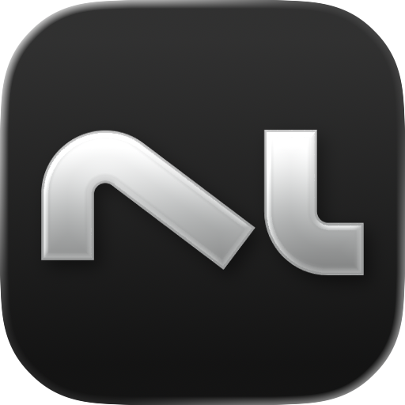
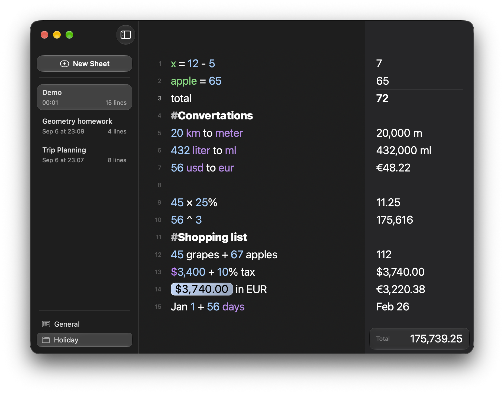
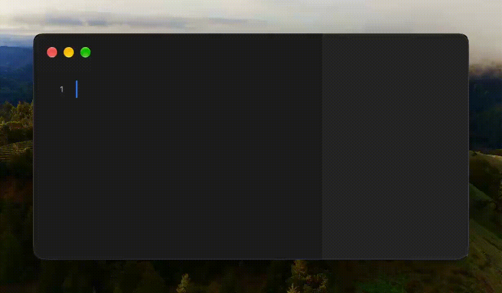

<p align="center">
  
</p>

<h1 align="center">Numlex</h1>

<p align="center">
  <a href="https://www.apple.com/macos/"></a>
  <a href="https://www.swift.org"></a>
  <a href="https://github.com/Qulierm/Numlex/releases/latest"></a>
  <a href="LICENSE"></a>
  <a href="https://github.com/Qulierm/homebrew-tap"></a>
  <a href="https://www.producthunt.com/products/numlex"></a>
  <a href="https://alternativeto.net/software/numlex/about/"></a>
</p>

<p align="center">
  A notepad calculator: type plain lines, get live, checked results — natural math,
  variables, percentages, dates, unit and currency conversions, and reusable
  live answer tokens.
</p>

<p align="center">
  <a href="https://github.com/Qulierm/Numlex/releases/latest">Download the latest release</a>
</p>

<p align="center">
  <a href="Assets/NumlexScreenshot.png">
    
  </a>
</p>

## Features

<table>
  <tr>
    <th>Variables &amp; Functions</th>
    <th>Natural Calculations</th>
  </tr>
  <tr>
    <td align="center"><a href="Assets/Demos/base.gif"></a></td>
    <td align="center"><a href="Assets/Demos/household.gif"></a></td>
  </tr>
  <tr>
    <td align="center"><em>Name values, apply functions, and totals stay live</em></td>
    <td align="center"><em>Arithmetic, percentages, section totals and dates — as plain lines</em></td>
  </tr>
  <tr>
    <th>Units &amp; Currencies</th>
    <th>Linked Answers</th>
  </tr>
  <tr>
    <td align="center"><a href="Assets/Demos/kilometres.gif"></a></td>
    <td align="center"><a href="Assets/Demos/linked.gif"></a></td>
  </tr>
  <tr>
    <td align="center"><em>Convert distance, temperature, mass and currency in one line</em></td>
    <td align="center"><em>Reuse any result as a bubble that stays in sync</em></td>
  </tr>
</table>

Numlex is a native, offline-first macOS notebook calculator. Enter ordinary
text lines for arithmetic, named values, percentages, functions, dates, money,
unit conversions, totals and more. Results update as you edit; reusable answer
tokens stay linked to their source. The engine uses explicit typed rules rather
than silently guessing at invalid input.

## User documentation

The user manuals live on the [Numlex documentation site](https://www.numlex.tech/docs/):

- [Linked answers](https://www.numlex.tech/docs/linked-answers/)
- [Sheets and files](https://www.numlex.tech/docs/sheets-files/)
- [Styling and constants](https://www.numlex.tech/docs/styling-constants/)

Published manuals describe released behavior and may lag `main`; source code
and tests define the behavior of the current branch.

## Download and install

Numlex requires macOS 26 or later on Apple silicon (arm64). Download the
[latest release](https://github.com/Qulierm/Numlex/releases/latest), open the
plain disk image, and drag **Numlex.app** into Applications. The image contains
only the app and an Applications shortcut.

Numlex is ad-hoc signed and not notarized, so macOS may show a first-launch
warning. If you downloaded it from the official release, use Finder's normal
Control-click (or right-click) → **Open** confirmation; do not disable
Gatekeeper.

You can also install from the project's custom Homebrew tap:

```sh
brew install --cask Qulierm/tap/numlex
```

This is the [Numlex tap](https://github.com/Qulierm/homebrew-tap), not the
Homebrew core cask. The same signing and first-launch guidance applies.

## Build and test

Building from source requires macOS 26 and Swift 6.2; Xcode Command Line Tools
are sufficient.

```sh
swift build
swift run NumlexTests
swift test                 # Swift Testing suite; full Xcode toolchain
bash Scripts/build-app.sh release
bash Scripts/relocated-app-smoke.sh
```

See [CONTRIBUTING.md](CONTRIBUTING.md) for repository structure, contributor
workflow, security guidance and validation expectations.

## License

Numlex is available under the [MIT License](LICENSE).
